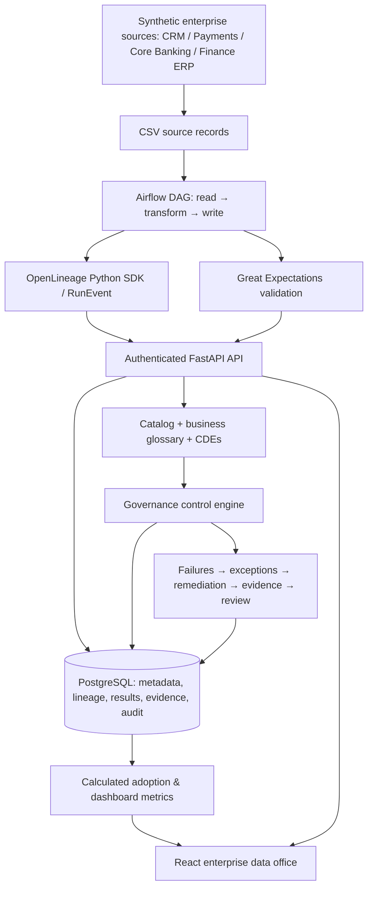
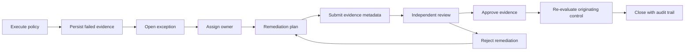
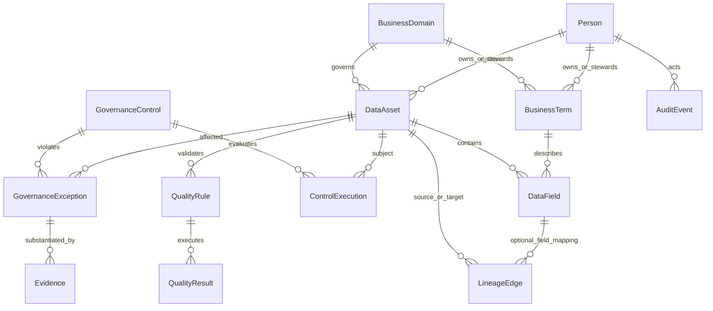

# Enterprise Data Governance & Lineage Platform

[](https://github.com/SriChaitanya1824/Enterprise-Data-Governance-Lineage-Platform/actions/workflows/ci.yml)

**Trace a critical field from source to regulatory report, discover governance gaps, and close them with independently reviewed evidence.**

A working financial-services portfolio project: FastAPI, PostgreSQL, React, Airflow, OpenLineage and Great Expectations. It demonstrates the operational work of an enterprise data office, including accountable ownership, business definitions, measured quality, traceability, policy execution, exception remediation and adoption assessment.

This is a synthetic banking environment, not a bank deployment or an attestation of regulatory compliance. No real customer information is used.


## Why this exists

Enterprise data is distributed across systems and divisions. Reporting teams need to know which fields are critical, what they mean, who is accountable, where they originate and whether the data satisfies quality and governance requirements. A list of datasets alone cannot answer those questions.

This platform connects business terms to physical fields, fields to accountable assets, assets to processing dependencies, and governance failures to evidence-backed remediation. Every control stores its observed evidence; dashboard percentages come from database records and measured validations.

## Two-minute tour

1. **Catalog:** 13 governed asset profiles across six business divisions, including CRM, payments, customer master, risk analytics and reporting.
2. **CDE profile:** inspect Customer Risk Rating, its approved definition, owner, steward, classification, quality checks and explicit field mappings.
3. **Lineage:** pan and zoom through source → raw → clean → master → risk → analytics → regulatory report; select an asset to inspect it.
4. **Controls:** execute eight policies and inspect persisted PASS / FAIL / SKIP evidence.
5. **Exceptions:** assign remediation, record a plan, submit private evidence metadata, request independent review and close only after the originating control passes.
6. **Adoption and audit:** compare actual governance coverage across divisions and inspect before/after changes.

## Capabilities

| Capability | Working behavior |
|---|---|
| Data catalog & metadata | Register, search, filter, inspect, edit and retire assets; preserve history |
| Accountability | Named owners and stewards; assignment-scoped metadata updates |
| Business glossary | Create/edit terms, approve through reviewer role, link physical fields; editing resets approval |
| CDE management | Mark fields critical, filter by division, inspect definition, accountability, quality, controls and lineage |
| Classification | Public, Internal, Confidential, Restricted; field sensitivity cannot exceed its containing asset |
| Lineage | Directional, transitive asset and field queries; interactive graph; cycle rejection; capture provenance |
| Automated lineage | Actual Airflow file transformation emits OpenLineage COMPLETE events into the authenticated platform API |
| Data quality | GX validates real CSV rows; rules, observed results, failed counts, timestamps and scores persist |
| Governance controls | Eight evidence-producing policies over active assets; repeatable run IDs and deduplicated active exceptions |
| Exceptions & evidence | Enforced state machine, assignment, plans, private references, independent evidence review and gated closure |
| Compliance monitoring | BCBS239 tags and source-to-report traceability; policy results support monitoring, not regulatory certification |
| Adoption | Seven calculated coverage measures by division, weighted enterprise score and open exception counts |
| Auditability | Actor, action, entity, timestamp, before/after values; no application edit/delete endpoints |
| Security | Argon2 passwords, expiring signed JWTs, role and assignment checks, validated inputs, explicit CORS and generated local secrets |

## Architecture



The backend is the system of record. Airflow authenticates as a service stakeholder and invokes the same services used by the UI. PostgreSQL is used in Compose; SQLite is supported for isolated unit/integration tests and optional local development.

### Traceability example

```text
CRM / customer_raw
  ↓ normalize codes; reject invalid rows
Customer Master / customer_clean
  ↓ deduplicate stable identifiers
Customer Master / customer_master
  ↓ approved risk classification
Risk Engine / customer_risk [risk_rating CDE]
  ↓ risk analytics projection
Risk Engine / credit_risk_dataset
  ↓ reporting population projection
Regulatory Reporting / regulatory_customer_report
```

These catalog relationships and field mappings are documented seed metadata. The Airflow pipeline executes the **raw → clean** transformation and captures that dataset dependency automatically. Downstream catalog relationships are not falsely presented as automatically executed processing jobs.

### Governance lifecycle



## Technology stack

| Layer | Technology | Responsibility |
|---|---|---|
| API | Python 3.12, FastAPI, Pydantic | REST, validation, OpenAPI and authorization |
| Persistence | SQLAlchemy 2, PostgreSQL 16, Alembic | Relational governance state and versioned schema |
| Authentication | pwdlib / Argon2, PyJWT | Password hashing and expiring bearer tokens |
| UI | React, TypeScript strict mode, Vite, React Router | Responsive enterprise workspace |
| Server state | TanStack Query | API queries, mutations and refresh after actions |
| Visualization | React Flow, Recharts | Interactive lineage, adoption and distributions |
| Orchestration | Apache Airflow 2.10.5 | Processing, quality and governance workflows |
| Lineage | OpenLineage Python SDK | Real processing event emission and ingestion |
| Quality | Great Expectations 1, pandas, pycountry | Actual row checks and ISO country validation |
| Packaging | Docker Compose, nginx | Reproducible services and frontend API proxy |
| Verification | pytest, Vitest, Testing Library, Playwright | Backend policy and workflow tests, UI journeys |
| Quality gates | Ruff, Black, mypy, ESLint, TypeScript | Formatting, lint and type checks |
| CI | GitHub Actions | Tests, migrations, build, Compose demo and DAG parsing |

Dependency resolutions are committed in `backend/uv.lock` and `frontend/package-lock.json`.

## Getting started

Prerequisites: Docker with Compose, Python 3 for generating local configuration, and Git. The core stack works without installing Python or Node dependencies on the host.

```bash
git clone https://github.com/SriChaitanya1824/Enterprise-Data-Governance-Lineage-Platform.git
cd Enterprise-Data-Governance-Lineage-Platform
make configure
make up
```

`make configure` creates `.env` with unique local credentials and deterministic synthetic files. It preserves an existing `.env`. Alternatively copy `.env.example` to `.env` and replace all example passwords and the JWT secret. Never commit `.env`.

| Service | Address |
|---|---|
| Frontend | http://localhost:3010 |
| Backend health | http://localhost:8010/health |
| Interactive API docs | http://localhost:8010/docs |
| OpenAPI schema | http://localhost:8010/openapi.json |
| Airflow, with orchestration profile | http://localhost:8085 |

The frontend proxies `/api` to the backend. PostgreSQL is on the private Compose network; no database host port is exposed. The backend migrates, generates synthetic files, and seeds on first startup. A populated catalog is preserved on subsequent seeds.

### Sign in

Read `BOOTSTRAP_PASSWORD` in your local `.env`. The initial synthetic accounts share that generated password for convenient role switching:

| Account | Role |
|---|---|
| `admin@example.test` | ADMIN |
| `governance_analyst@example.test` | GOVERNANCE_ANALYST |
| `data_owner@example.test` | DATA_OWNER |
| `data_steward@example.test` | DATA_STEWARD |
| `reviewer@example.test` | REVIEWER |

Airflow uses username `admin` and `AIRFLOW_ADMIN_PASSWORD` from `.env`. These bootstrap conventions are for a local demo. Enterprise deployment needs individual credential provisioning and service identities.

### Enable real orchestration

```bash
make up-all
make airflow-check
docker compose --profile orchestration exec airflow-scheduler airflow dags unpause metadata_sync
docker compose --profile orchestration exec airflow-scheduler airflow dags trigger metadata_sync
```

The metadata DAG reads `raw/customers.csv`, normalizes and filters records, writes the curated CSV, emits an SDK-generated OpenLineage event and transfers the actual output into backend storage. Quality validation and governance control tasks follow it. Separate `data_quality_validation` and `governance_control_execution` DAGs can also be triggered. No random quality numbers or simulated DAG results are returned.

Marquez is **optional and not bundled**: the platform stores and visualizes OpenLineage events itself. `MARQUEZ_URL`, when set to a reachable Marquez service, enables a second SDK emission. No Marquez deployment or Collibra integration is claimed.

### Reproducible execution commands

```bash
make quality-check       # Execute GX against the catalog's synthetic CSV files
make controls            # Persist all active policy results and create exceptions
make seed                # Non-destructive seed: exits if catalog already exists
make down                # Stop services; preserve the PostgreSQL volume
```

### Local development

Requires Python 3.12+, [uv](https://docs.astral.sh/uv/), Node 24 and npm. Keep the generated root `.env`; use SQLite explicitly for host development:

```bash
make configure
uv sync --project backend --frozen
npm --prefix frontend ci
cd backend
# Load generated secrets from ../.env, override only the local database URL.
DATABASE_URL=sqlite:///./governance.db uv run --env-file ../.env alembic upgrade head
DATABASE_URL=sqlite:///./governance.db uv run --env-file ../.env python -m app.cli seed
DATABASE_URL=sqlite:///./governance.db uv run --env-file ../.env uvicorn app.main:app --reload --port 8010
# In a second terminal at repository root:
npm --prefix frontend run dev
```

Local Vite runs on http://localhost:5174 and proxies API requests to port 8010. `VITE_API_URL` is build-time configuration; the default `/api` works through both development and nginx proxies.

## Data model



IDs and references are foreign keys. Asset names, glossary names, field names per asset, quality rule names per asset and event/run keys are unique. A partial unique index prevents more than one non-closed exception for an asset/control pair. New failures after closure create new historical exceptions. Common asset, division, classification, CDE, exception severity and status queries are indexed.

Asset removal is retirement. Exceptions and audit records have no delete or edit endpoints. Evidence files are not exposed by a static file server; only validated private references and document metadata are stored.

## How lineage works

The OpenLineage Python SDK describes a job, a stable run UUID, event time, inputs, outputs and producer. The authenticated event receiver deduplicates `(run ID, job name, event type)`. COMPLETE events resolve datasets using both catalog name and source namespace, then insert or refresh dataset dependencies with provenance and run IDs. Unknown datasets are rejected rather than silently attributed to an unrelated asset.

Curated field mappings are explicit source/target field references, validated against their containing assets. Upstream and downstream traversals are separate and transitive; a combined query avoids incorrectly traversing into unrelated sibling branches. Documented edges cannot introduce cycles. See [lineage design](docs/lineage.md).

## How quality works

GX executes registered expectations against real pandas batches. Seeded rules cover identifiers not null/unique, mandatory names, ISO 3166-1 alpha-2 countries, allowed LOW/MEDIUM/HIGH risk ratings, nonnegative amounts and required business/transaction dates.

Each result stores rule, field via rule reference, asset, expected parameters, actual GX metrics, strict pass/fail, severity, run and execution timestamp. **Asset score = mean row success rate across the latest result for each rule.** Null/invalid rows and duplicates affect measured rates. Missing results are unmeasured, not 100%. The raw samples deliberately contain a few defects; curated datasets start clean. Strict expectation failure and 99% row quality can coexist.

The 95% policy is an explicit demo threshold; it is not asserted to be a bank or regulator's requirement. See [quality methodology](docs/data-quality.md).

## Governance controls

| Code | Scope and requirement |
|---|---|
| OWNERSHIP | Critical assets and assets with CDEs require a named owner |
| STEWARDSHIP | Critical assets and assets with CDEs require a named steward |
| METADATA | Active assets require description, source system and physical location |
| CLASSIFICATION | Valid asset classification; fields cannot be more sensitive than the asset |
| CDE | CDEs require accountable owner/steward, field definition, classification and approved glossary term |
| LINEAGE | Regulatory assets require upstream source traceability; their CDEs require field mappings |
| QUALITY | Critical assets require observed quality ≥95% |
| REVIEW | Active governed assets need a review in the previous 90 days |

Executions persist PASS, FAIL or SKIP plus observed evidence. The engine locks active assets during PostgreSQL execution to serialize exception creation. Failure does not automatically close when metadata changes; a reviewer must approve evidence and the control must pass again. See [control semantics](docs/governance-controls.md).

## Authentication, authorization and audit

JWTs are signed with an environment secret, expire after 60 minutes by default, and validate issuer and audience. The server reloads the user's active status and role from the database on each request. Tokens are stored in session storage in this local UI.

- **ADMIN:** create stakeholders and business domains; operational actions, subject to independent evidence-review restrictions.
- **GOVERNANCE_ANALYST:** register and edit governed metadata, terms, fields and lineage; execute quality and controls; assign exceptions and submit remediation evidence.
- **DATA_OWNER / DATA_STEWARD:** read governance records; update description/review date for assigned assets; progress assigned remediation and submit evidence.
- **REVIEWER:** approve glossary terms; independently review evidence and accept/reject remediation. Cannot approve their own evidence or close their own assigned remediation.

All authenticated stakeholders can read the synthetic governance catalog. This is role-based workflow authorization, not a production field-level confidentiality enforcement system. Actor/action/entity/timestamp and before/after values are recorded for consequential mutations. There are no normal application routes for audit edits.

## Demo walkthrough

The seeded `customer_risk` deliberately lacks an owner; `corporate_exposure` lacks lineage; `finance_ledger` has a stale review. These are visible on first startup.

1. Sign in as the governance analyst and open Dashboard.
2. Open Critical Data Elements, filter Risk Management and choose Customer Risk Rating on `customer_risk`.
3. Inspect the unassigned owner, steward, approved definition and classification.
4. Open Lineage to trace the field from raw data through the regulatory report.
5. Open Quality to inspect actual rule results and score.
6. Execute Governance Controls; inspect failed ownership and CDE evidence.
7. Open the ownership exception on `customer_risk` and assign the Data Owner.
8. Start remediation and record an ownership attestation plan.
9. In the asset profile, assign Risk Data Owner using the analyst account.
10. Switch to the data owner and submit evidence metadata with a private reference.
11. Request review, then sign in as the independent reviewer.
12. Approve the evidence with a rationale and close the exception.
13. Re-run controls and observe current metrics. Other failures remain tracked until separately remediated.
14. Inspect Audit Log for metadata and lifecycle history.

For an automated end-to-end API demonstration against running Compose:

```bash
uv sync --project backend --frozen
make demo
```

The script intentionally creates an ownership gap, executes controls, repairs ownership, submits evidence as the owner, reviews as a separate reviewer, closes, and records the final run. Repeat runs preserve history. [Full demo and field-lineage failure scenario](docs/demo.md).

## Repository structure

```text
backend/
  app/api/          # Identity, catalog, lineage, governance and reporting routes
  app/core/         # Validated settings, sessions, authentication and authorization
  app/models/       # Relational entities, keys, indexes and timestamps
  app/schemas/      # Validated mutation inputs
  app/services/     # Seed, audit, metrics and exception state machine
  app/governance/   # Policy evaluator and exception generation
  app/lineage/      # Directional traversal and OpenLineage receiver
  app/quality/      # GX execution and latest-rule scoring
  alembic/          # Versioned migration
  tests/            # Isolated API and policy integration tests
frontend/
  src/components/   # Tables, forms, badges, lineage graph
  src/pages/        # Catalog, CDEs, glossary, workflows and dashboards
  src/services/     # Authenticated HTTP transport
  src/types/        # Strict typed API views
  tests/            # Component journeys and live Playwright tests
airflow/dags/       # Real processing, quality and control DAGs
data/raw/          # Synthetic defective input records
data/sample/       # Synthetic banking datasets
data/curated/      # Generated and transformed outputs (not committed)
governance/        # Policy configuration reference and rule definitions
docs/              # Architecture, model, APIs, semantics and demo
scripts/           # Config, deterministic sample generator, live demo
.github/workflows/ # CI gates and live integration
```

## API reference

FastAPI exposes interactive OpenAPI at `/docs`. Most list endpoints support bounded `page` / `page_size` with items/total/page/page_size. Quality latest-results returns the latest result per rule. Search bounds matches per entity type.

| Group | Examples |
|---|---|
| Authentication / stakeholders | `POST /api/auth/login`, `GET /api/auth/me`, `GET/POST /api/users` |
| Domains / assets | `GET/POST /api/domains`, `GET/POST /api/assets`, `GET/PATCH/DELETE /api/assets/{id}` |
| Fields / CDEs | `GET/POST /api/fields`, `PUT /api/fields/{id}`, `GET /api/cdes`, `GET /api/cdes/{id}` |
| Glossary | `GET/POST /api/business-terms`, `GET/PUT /api/business-terms/{id}`, `POST .../{id}/approve` |
| Lineage | `GET /api/lineage/assets/{id}`, `.../fields/{id}`, `.../upstream/{id}`, `.../downstream/{id}` |
| Capture / ingestion | `POST /api/lineage/events`, `POST /api/lineage/edges`, `POST /api/ingestion/customer-clean` |
| Quality | `GET /api/data-quality/rules`, `GET .../results`, `POST .../run` |
| Governance | `GET /api/governance-controls`, `POST .../run`, `GET /api/control-executions` |
| Exceptions / evidence | `GET /api/exceptions`, `GET .../{id}`, `POST .../{id}/transition`, `GET/POST /api/evidence`, `POST .../{id}/review` |
| Reporting | `GET /api/dashboard`, `/api/adoption`, `/api/audit`, `/api/search?q=...` |

401 means invalid authentication, 403 means forbidden role/assignment, 404 means unknown record, 409 means a duplicate or invalid workflow state, and 422 means invalid input/reference/policy preconditions. See [API guide](docs/api.md).

## Testing & CI

```bash
python3 scripts/generate_sample.py
uv sync --project backend --frozen
npm --prefix frontend ci
make test
make lint
make build
# With Compose running:
cd frontend && npx playwright install chromium && npm run test:e2e
# DAG parse checks with the orchestration image:
make airflow-check
```

Backend tests include authentication, asset operations and validation, glossary approval reset, CDE profiles, classification consistency, directional/field lineage, cycle protection, OpenLineage duplicate handling, measured quality, control-run idempotency, exception deduplication, authorization, calculated adoption, private evidence references and a complete CDE lineage failure → remediation → independent review → closure → recurrence scenario.

Frontend tests exercise authentication errors, CDE filtering/detail links and exception filters. Live Playwright journeys traverse the running PostgreSQL-backed application and produce dashboard/mobile screenshots. CI runs backend lint/type/tests, migration and seed checks, frontend lint/type/tests/build, a Docker Compose API demo, live browser journeys and Airflow DAG parsing. The badge reflects the actual workflow status, not a manually asserted pass.

## Governance concepts demonstrated

| Enterprise concept | Implementation evidence |
|---|---|
| Data Governance | Policy definitions, executions, accountable roles and controlled remediation |
| Data Management | Catalog inventory, source metadata, lifecycle retirement and synthetic processing |
| Data Lineage | Transitive directional graphs, field mappings and OpenLineage job capture |
| Data Quality | GX row validations, persisted observed metrics and threshold control |
| Data Ownership | Named accountable asset owners; ownership gaps generate exceptions |
| Data Stewardship | Steward assignments, scoped updates and remediation accountability |
| Critical Data Elements | Explicit field criticality and complete governance profiles |
| Metadata Management | Business/technical attributes, glossary linkage, approval and classification |
| Compliance Monitoring | Regulatory relevance, BCBS239 tags, review and traceability checks |
| Exception Management | Deduplicated failures, assignment, plans, evidence, independent review and gated closure |
| Auditability | Actor and before/after records linked to metadata and workflow actions |
| Governance Adoption | Calculated division coverage and transparent scoring methodology |

## Implemented, simulated and future

**Implemented:** authenticated APIs, actual PostgreSQL persistence and migrations, interactive UI, real GX execution, real Airflow raw-to-clean processing, SDK-generated OpenLineage capture, documented field mappings, controls, exception workflow, evidence metadata, calculated metrics and audit trail.

**Synthetic/demo:** enterprise systems, business divisions, users, financial records, BCBS239 tags and downstream transformation documentation. Evidence references are metadata attestations, not uploaded or cryptographically verified files. The seed intentionally includes governance gaps.

**Limitations:** no SSO/MFA, refresh-token system, enterprise tenant isolation, malware-scanned uploads or external source connectors. Audit is append-only through application routes, not a tamper-proof external ledger. Pipeline capture is dataset-level for one actual transformation; full automatic field lineage is not implemented. The lineage policy verifies documented dependencies, not all branches of an enterprise reporting graph. Quality checks run against local synthetic CSV files. Catalog lists are database-paginated; some portfolio-scale metric computations read the catalog in memory. Core services are not configured as a highly available public production deployment.

**Future integrations:** Collibra-compatible catalog mapping, enterprise IAM, object storage evidence with hashes, policy-as-code, additional lineage providers, cloud deployment, reporting-specific completeness policies, data contracts, control scheduling SLOs and external audit retention. No Collibra, Data Exchange Registry or cloud catalog integration is claimed.

## Documentation

- [Architecture and deployment](docs/architecture.md)
- [Relational model and constraints](docs/data-model.md)
- [Lineage and capture scope](docs/lineage.md)
- [Governance controls](docs/governance-controls.md)
- [Quality methodology](docs/data-quality.md)
- [Exception workflow](docs/exception-workflow.md)
- [API contracts](docs/api.md)
- [Reproducible demonstration](docs/demo.md)

MIT licensed. This repository demonstrates governance engineering concepts using synthetic financial data.
# Enterprise-Data-Governance-Lineage-Platform
